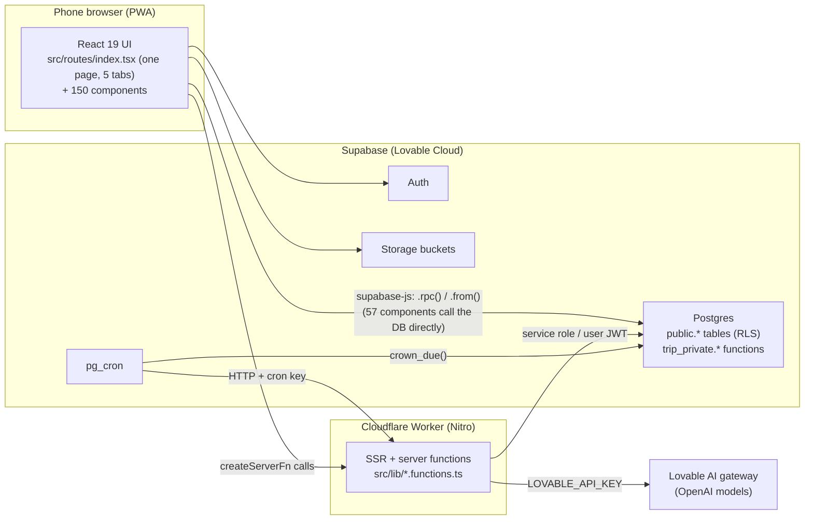

# 01 — Current State of the Codebase

> Snapshot of `tripjunkie-main` as exported on **Oct 6, 2026**. The last migration is `20261006024714_…sql`.
> On Oct 19, 2026, `bun install`, `tsc --noEmit` and `vite build` were all run against it. **All three passed with no errors.**

---

## 1. Tech stack

| Layer | Technology | Notes |
|---|---|---|
| Language | **TypeScript** (frontend + server functions), **SQL / PL/pgSQL** (backend rules) | |
| UI framework | **React 19** | |
| App framework | **TanStack Start** 1.168 (full-stack React with SSR) + **TanStack Router** 1.170 (file-based routes) + **TanStack Query** 5 | Template `tanstack_start_ts_current` from Lovable |
| Build | **Vite 8**, configured through `@lovable.dev/vite-tanstack-config` | That package bundles the React, Tailwind, tsconfig-paths, Nitro and TanStack plugins. See [07](07-dev-setup-and-lovable-exit.md) |
| Styling | **Tailwind CSS v4**, **shadcn/ui** (Radix primitives in `src/components/ui`), `tw-animate-css`, lucide icons | `src/styles.css` is **227 KB** (two visual "looks" + per-page scenes) |
| Forms / validation | react-hook-form, **zod** | |
| Server code | TanStack Start **server functions** (`createServerFn`) in `src/lib/*.functions.ts` / `*.server.ts` | 23 server functions: AI, checkout, delete trip/account, test lab |
| Hosting | **Nitro → Cloudflare Workers** (`.output/server/wrangler.json` is generated at build) | Hosted by Lovable today |
| Database | **Supabase Postgres** ("Lovable Cloud"), project id `kymflipjxxpyxksdfgdw` | About 125 tables, about 720 functions, 299 migration files |
| Auth | Supabase Auth: email/password plus **Google through `@lovable.dev/cloud-auth-js`** | Apple sign-in is not built |
| Storage | Supabase Storage buckets: `trip-photos`, `quest-proofs`, `player-avatars`, `culture-photos`, `inspiration-photos`, `window-guide`, `bug-screenshots` | Private buckets with signed URLs |
| Scheduled jobs | **pg_cron**: `crown-due-seasons` (every 15 min → `trip_private.crown_due()`), `purge-expired-trip-photos` (daily → `/api/public/purge-photos`) | |
| AI | **Vercel AI SDK** (`ai`, `@ai-sdk/openai`) pointed at **Lovable's AI gateway** (`https://ai.gateway.lovable.dev/v1`, `LOVABLE_API_KEY`) | Text only. No image/vision calls anywhere |
| App packaging | **Manifest-only PWA** (`public/manifest.webmanifest` + icons) | **No service worker** (on purpose, see `src/AGENTS.md`), **no native app** |
| Payments | `checkout_beta` writes an `orders` row; `app_settings.beta_free` forces $0 | No payment provider wired up |
| Tests | **None** | |
| Package manager | **bun** (`bun.lock`); npm also works | |

---

## 2. How it fits together



**Key pattern:** almost every game rule is a `SECURITY DEFINER` function in the **`trip_private`** schema.
- Each one checks identity and role itself: `is_trip_member`, `is_captain`, `is_leader`, `is_app_admin`.
- A thin `public.*` wrapper function exposes it as an RPC.
- RLS **denies direct writes** to most game tables, so clients can't forge scores.
- Keep this pattern. It's the right one for a competitive game.

**Database rules worth reading before touching SQL:** `supabase/AGENTS.md` (40+ bullet rules) and `src/AGENTS.md`. They are the closest thing to design docs.

---

## 3. Repository map

```
tripjunkie-main/
├─ AGENTS.md, src/AGENTS.md, src/components/AGENTS.md, supabase/AGENTS.md   ← rules Lovable followed (read these)
├─ roadmap.md            ← 40+ "rounds" of Lovable work: 245 done, 83 open (66 open items are "verify signed-in…")
├─ README.md             ← original brief for "Squad Season" (outdated: old palette, spinning wheel, 4 how-it-works screens)
├─ .lovable/plan/*.md    ← Lovable's plans for recent rounds (useful history)
├─ docs/                 ← BRAND.md, AVATARS.md, PLAY_AND_EXPERIENCES.md, A2E_PART4_ART_LIST.md, brand/ images
├─ .env                  ← Supabase URL + publishable key only (safe to commit; no secrets)
├─ null                  ← stray file holding a shell error message; delete it
├─ public/               ← manifest, icons, robots.txt
├─ supabase/
│  ├─ config.toml        ← project_id only
│  └─ migrations/        ← 299 files, Oct 1–6 2026, nearly all auto-named <timestamp>_<uuid>.sql
└─ src/
   ├─ routes/
   │  ├─ __root.tsx      ← app shell, auth context, Query client, error boundary, update prompt
   │  ├─ index.tsx       ← ⚠ 3,150 lines / 118 KB: sign-in, onboarding, ALL FIVE TABS, founder dashboard
   │  ├─ join.$code.tsx, beta.$code.tsx, about.tsx, reset-password.tsx, legal/$document.tsx, home-mockups.tsx
   │  └─ api/public/purge-photos.ts, version.ts
   ├─ components/        ← 150 files (≈1.15 MB of TSX), very dense: 79 lines are over 1,000 characters
   │  └─ ui/             ← shadcn/ui primitives (keep)
   ├─ lib/               ← 60 helpers: *.functions.ts (server functions), *.server.ts (server-only), domain helpers
   ├─ integrations/
   │  ├─ supabase/       ← client.ts, client.server.ts, auth-middleware.ts, types.ts (7,400 lines, generated), cron-auth.ts
   │  └─ lovable/        ← Lovable OAuth wrapper (auto-generated)
   ├─ assets/            ← ~200 images (avatars, scenes, icons; webp/jpg; some *.asset.json CDN pointers)
   ├─ hooks/, server.ts (SSR error wrapper), start.ts, router.tsx, routeTree.gen.ts (generated)
```

### Bottom tab bar today
`Home · Play · Trip · Squad · Me`, held as React state inside `index.tsx`. **Tabs have no URLs.** The deck only explicitly describes Home, Play and Me; see [06-open-questions.md](06-open-questions.md) Q6.

### Biggest components (rough size = complexity)
`Seasons` 68k · `GameNights` 52k · `TripDayGames` 43k · `CultureExperiences` 42k · `PlayHub` 40k · `Season` 36k · `GameArcade` 34k · `AtHome` 32k · `TestLab` 28k · `Inspiration` 28k · `HomeDashboard` 26k · `PlayerCards` 26k · `TripCosts` 26k · `PassportBook` 25k · `BetaAccess` 24k · `MeExtras` 23k · `HomeLayoutMockups` 22k · `CaptainTools` 21k

---

## 4. Code health findings

| # | Finding | Impact | Addressed in |
|---|---|---|---|
| H1 | **No tests at all**, and signed-in flows were never verified (66 open "verify" items in `roadmap.md`) | Unknown number of broken flows; risky refactors | M0 |
| H2 | **Up to three rule generations at once.** Trips branch on `season_rule` (`legacy` / `a2c`), `a2e_room` / `a2e_kind`, `kind` (`trip` / `at_home`), `play_arrangement`. Lovable was told never to change existing trips | Every feature has 2–3 code paths; the deck's single engine can't be built on top cleanly | M1 + [06](06-open-questions.md) Q1 |
| H3 | **Scoring is a union of many sources** in `trip_private.season_points` (game-night attendance, wins and hosting, Question of the Week, host penalties, late-joiner `start_stamps`, sealed quests, missions, trip-day stamps, speed bonus). Trip Season is *also* normalised to /100 in `trip_season_score` | Doesn't match the deck's points table; hard to audit | M3 (points ledger) |
| H4 | **The whole app is one route** (`index.tsx`, 3,150 lines) | No deep links, hard to split code, merge conflicts | M1 |
| H5 | **Two complete visual "looks"** ("Original" and "Cinematic") switched per page by founder setting (`src/lib/look.tsx`, `app_settings.look`) | Every screen built twice; 227 KB CSS | M1 |
| H6 | **Dense, generated code style**: very long single lines, about 100 `as any` / `as unknown as` casts (many to call RPCs the generated types don't know) | Hard to review; type safety bypassed | M1 (Prettier, regenerate types) |
| H7 | **57 components call Supabase directly** (`supabase.rpc`, `.from`) | No data layer; logic is scattered | M1 / ongoing |
| H8 | **299 auto-named migrations** with many `CREATE OR REPLACE` rewrites of the same functions | Hard to see the current definition of anything | M0 (dump) / M1 (baseline) |
| H9 | **Tied to Lovable** in auth (Google OAuth), the AI gateway, the cron secret, error reporting, preview auth storage, Vite config and hosting | You can't run production without Lovable until these are replaced | M0 |
| H10 | **No service worker**, so the app shell can't load offline | Deck priority ★02 (offline on flights) impossible as-is | M4 |
| H11 | No push or email notifications; reminders are `.ics` downloads only | Deck priority 07 | M4 |
| H12 | Feature switches per trip (`trip_features`, `FeatureGate`, `level = full / preview`) plus Test Lab "preview" mode | Useful for beta, but more branching | M1 (simplify) |
| ✅ | **Server-enforced rules, RLS and identity checks** are thorough and well commented | Keep and extend | — |
| ✅ | **Test Lab**: sandbox trips, bots, time travel, presets (`TestLab.tsx`, `lab.functions.ts`, `trip_private.lab_*`) | Already covers the deck's "way to run test trips" | Keep (M6 polish) |
| ✅ | **Age gates** enforced in the database (`guard_auth_signup_age`, `set_teen_dob`, `join_trip`, `has_minors` trigger) | Keep; re-check against deck rules (R-904) | M6 |
| ✅ | **AI safety plumbing**: shared `RULES` in `content-rules.ts`, `safeContent`, DB phrase guard, `ai_gate` kill switch and daily caps | Keep; extend to images | M6 |

---

## 5. Built vs. deck — gap matrix

Legend:
- ✅ built and matches the deck (still needs signed-in verification)
- 🟡 partly built, or built to older rules
- ❌ not built
- 🗑 built but the deck no longer asks for it (see [05](05-legacy-retire-list.md))

### Deck Phase 1 priorities (slide 23)

| # | Priority | Status | What exists | What's missing |
|---|---|---|---|---|
| ★01 | Downloadable app (App Store + Google Play) | ❌ | Manifest PWA, icons | **No store apps** (Q16, Oct 31, 2026): an installable web app takes their place (M4-01), with Web Push (M4-08) |
| ★02 | Offline play on flights, sync later | 🟡 | `GameArcade` / "Games on the Flight", `OnePhoneNight`, `offline-trip-content.ts`, `OfflineTripCards` use local data | Service worker / bundled assets; offline queue; sync |
| 03 | Automatic time zones | 🟡 | `trips.home_timezone`, `trips.trip_timezone`, `trip_today()`, viewer time in `profiles.time_zone` | Trip zone is **picked by hand** (`TripTimezoneField`, Captain-only); no lookup from destination (beta bug: Bali → New York time) |
| ★04 | Captain setup flow + Play in every room | 🟡 | Trip create: 3 steps (`TripSheets`: dates → who → details). Culture rooms: 6 steps (`CultureA2eSetup`: who → place → dates → style → players → finale). Play hub with 4 phases (`PlayHub`) | The 5-screen flow from the deck; one flow for every room; Daily Card ("Soon"); empty Play for At Home / Window Seat (beta note) |
| ★05 | Points, crowns, Crew Check, Game Night Live | 🟡 | `season_points`, `season_champions`, `finalize_season`, `crown_due` cron, `CrownCelebration`; sealed quests + Showcase; Airport Missions capped at 12 | Deck points table; Early Bird / Jet Setter naming and rules; **Crew Check**; **Game Night Live** (avatar voting, Show & Tell 👍, secret Awards, Close/Reopen/auto-close); solo goal |
| 06 | Postcard Picks, collage, passport stamps | 🟡 | `passport_stamps` (country/state), culture postcards, photo wall + zip + collage (`Seasons.tsx`), Wrapped story | Nominate 2 → heart → 3 questions → Day 7 lock; collage template; photo deletion rule; "Trip Postcard" ("Soon") |
| 07 | Reminders + notification settings | ❌ | `.ics` downloads (`flight-calendar.ts`, `flight-reminders.ts`) | Push, email backup, per-type mute, quiet hours, scheduler |
| 08 | AI photo checks + moderation (flags only) | 🟡 | Photo reports (`photo_reports`), inspiration moderation log, two-member verification for scavenger | AI image checks for Bingo / Scavenger / Photo games |

### Everything else in the deck

| Area (deck slide) | Status | Notes |
|---|---|---|
| Rooms: Going on a Trip, Window Seat, Explore a Culture, Show Your Culture, Game Night (2) | 🟡 | All exist, but as separate implementations (`kind`, `a2e_kind`, `AtHome`, `CultureExperiences`, `SoloGuide`, `GameArcade`) instead of one engine with room config |
| Four phases + banners (3) | 🟡 | `datePhase` / `phaseBanner` in `play-arrangement.ts`; phase 4 is called **"Wrapped"**, not Baggage Claim; banners exist; late start works for new rooms |
| "We've arrived" + automatic backup at 11:59 PM next night (3) | ✅ | `confirm_departure` + `trip_season_start_at` ✅. Captain **or Co-Captain** (`is_leader`), in SQL and in `PlayHub` (confirmed by `supabase/tests/database/03_takeoff.test.sql`) |
| Who's playing: Just me / Crew / Friends off the app (4) | ✅ | `PlayingChoice` (`solo` / `online` / `offline`); offline roster is device-local. Roster starts at 2 names (beta note) |
| Captain view & tools per phase (6, 16) | 🟡 | `CaptainTools`, `CaptainExtras`, `CaptainChecklist` exist; not one tile per phase |
| Co-Captain = every power except delete (6, 16) | 🟡 | `co_captain` role exists, but time zone, trip pot and some setup are `is_captain`-only |
| Play tab hub + phase pages + face cards (7) | ✅ / 🟡 | `PlayHub` matches the structure; card contents are a mix of old and new |
| Pre-Flight: Daily Discovery on Home, Daily Card on Play (3, 8) | ❌ | Not built (Question of the Week 🗑 and practice prompts exist instead) |
| Sealed quests: drop 3 days before each night, +5 if opened within 3h (8, 12) | ✅ / 🟡 | `sealed_quests`, `sealed_drops`, `sealed_award`; check the timing matches R-312 |
| Showcase 20 pts (12) | ✅ | `kind='showcase'` in `sealed_quests` |
| Up to 4 game nights on video call (3, 5) | 🟡 | Old model: weekly nights, host rotation, spin wheel, cards, turns, finale vote. Call links ✅ (`call_link`, `backup_call_link`) |
| Airport Missions: 3 sealed, 24h, proof until Trip Season, cap 12 (8, 12) | ✅ | `mission_claims` / `mission_action` / `mission_window` |
| Home Missions (At Home Takeoff) (5, 10) | ✅ / 🟡 | Exists as a title; check content |
| Games on the Flight: free, offline, no points (3) | ✅ | `GameArcade`; needs offline support (M4) |
| Trip Season: Daily Discovery, Surprise Drops, trip quest per player (8) | ❌ / 🟡 | Daily trip-day games exist (bingo, quests, trivia, secret missions, photo challenge, MVP: `TripDayGames`, `trip_day_games`), but not the Surprise Drop model |
| Crowning night with date/time/place (3, 5) | 🟡 | `finale_at` / `finale_place` exist for culture rooms; old trips used "Takeoff Night" / departure crowning |
| Window Seat daily quest 5 + journal 2 (9) | 🟡 | `SoloGuide`, `solo_quests`, `window_guide_items`; **no journal prompts** |
| Explore / Show Your Culture, 11 focuses, 1–7 days, finale (10) | 🟡 | `CultureExperiences`, `culture_*` tables, showcase ballots; check focus list and day limits |
| Game Night & Crew Check (11) | ❌ | See ★05 |
| Postcard Picks (13) | ❌ | See 06 |
| Passport profile, levels, badges (14) | 🟡 | `PassportBook`; levels are "Traveler / Explorer / Passport Junkie", not the 8-step ladder; badges not built; Junkie Rank 🗑 |
| Public / private profile (14, 15) | ❌ | Only `player_profiles.public_leaderboard` |
| World map (15) | ❌ | `JourneyMap` is one trip's journey, not the global map |
| Me tab (16) | 🟡 | `MeExtras` + settings; missing About me, top stamps, hide trip/photo, public/private, notification settings |
| Explore tour, 7 swipe cards (17) | 🟡 | `ExploreTour` / `CinematicTourSlides` has 13 slides with more detail than the deck wants |
| Languages (18) | ❌ | English only, strings hard-coded |
| Founder tools (18) | ✅ | Founder dashboard, Test Lab, beta codes, bug inbox, AI spend guard, feature switches |
| Rules & limits (19) | 🟡 | Group max 12 + teams above that; max 14 days unverified; ages enforced (re-check); prices in `price_rules` |
| Beta notes (20) | ❌ | 8 issues open; most go away with the new setup flow (M2) |
| Airline Look design (21–22) | 🟡 | "Cinematic" look is closer to the deck's palette; airline elements (boarding pass, ticket stubs, luggage tags) partly present |

### Built, but not in the deck (🗑, summary; full list in [05](05-legacy-retire-list.md))
- Spin wheel, host rotation, host swaps, no-show penalties, skip passes
- Question of the Week, live quick votes
- Trip pot / cost splitting
- Junkie Rank, AI credit wallet and tiers
- Teams for groups of 12 or fewer
- Party cards / sip-or-skip (keep only the 21+ alcohol filter)
- Game Rooms public listing, Travel From Home "inspiration" cards
- Home layout mockups, the "Original" look, trip feedback form *(keep?)*, Early Check-In
